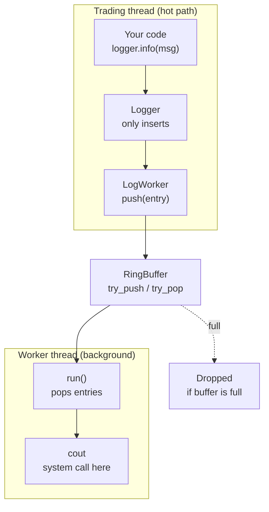
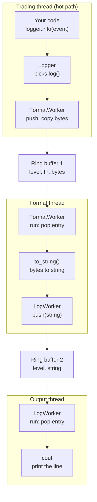

# Low Latency Async Logger

Logger is essentials in every kind of system, it really help the developer to see what's happening when the application is running.

```
09:30:00.000184512 INFO  [md-feed ] Connected to feed session=MD01 seq_start=1048200
09:30:00.000231007 INFO  [gateway ] Order session logged in session=OE01 next_seq=5001
09:30:00.104882113 DEBUG [md-feed ] Tick AAPL bid=189.42x300 ask=189.43x500 seq=1048231
09:30:00.104882990 DEBUG [strategy] Signal BUY AAPL px=189.43 qty=100 reason=imbalance(0.62)
09:30:00.104883410 DEBUG [risk    ] Risk OK AAPL pos=0->100 notional=18943 limit=500000
09:30:00.104884102 INFO  [gateway ] NEW   id=7001 BUY AAPL 100@189.43 IOC tick_to_trade=1989ns
09:30:00.104931557 INFO  [gateway ] ACK   id=7001 exch_id=X88412 rtt=47us
09:30:00.104933020 INFO  [gateway ] FILL  id=7001 100@189.43 pos=100
09:30:00.212449871 WARN  [md-feed ] Seq gap MSFT expected=1048302 got=1048305, requesting snapshot
09:30:00.213002410 INFO  [md-feed ] Snapshot applied MSFT, book rebuilt seq=1048305
09:30:00.318774105 WARN  [risk    ] Blocked TSLA SELL qty=500: max position 300 exceeded
09:30:00.401220876 ERROR [gateway ] REJECT id=7004 reason="price outside limit band"
09:30:01.000000000 INFO  [stats   ] 1s: ticks=184211 orders=37 fills=29 t2t p50=1.9us p99=6.4us max=41.2us
09:30:01.000001200 WARN  [logger  ] Queue full on thread strategy, dropped 12 messages
```

Without logger, we don't know what our system has been going through, maybe our system processed something that shouldn't be processed at all, maybe our system got an error, etc.

## How we want to use this logger

### Fast & Asynchronous

We are working on Low Latency System, that means every microsecond is important for us, having a slow logger will kills our entire performance in systems, we don't want this to happens.

### Handle the log level

Usually there's 4 types of log level in logger

#### Debug

This is useful while developing and debugging

Example log for this

```
DEBUG [strategy] Signal BUY AAPL px=189.43 qty=100 reason=imbalance(0.62)
```

It's just shows why the strategy wants to buy AAPL stock at that point of time. But this is too frequent and too detailed when this goes to production environment.

#### INFO

Normal stuff that useful to know if we record this

Example log for this

```
INFO  [gateway ] FILL id=7001 100@189.43 pos=100
```

This log tells the reader that trade happened, that means money is moving, something that related to money is always worth to log.

#### WARN

Something unexpected happened, but didn't make the system goes down.

Example log for this

```
WARN  [logger  ] Queue full on thread strategy, dropped 12 messages
```

When queue is full, that's when developer need start to jump in and debug what's wrong with the system, it will make the system behave not correctly, but it will not make our system goes down or the impact of it can be ignored.

#### ERROR

It's way worse than WARN, if this happens, please fix your system immediately.

Example log for this

```
ERROR [md-feed ] Snapshot timed out for MSFT, symbol halted
```

When snapshot timed out for specific stock, that means the Orderbook for our system is not updated correctly, making the decision making of Strategy system has a high chance of false positive or making the Strategy system got shutdown for some specific stock, the impact is huge, we need to fix this.

## Interface

Based on the requirement that we have, we concluded the interface will look like this. Although we're gonna "break" this interface for performance reason, but for now, this is good enough for simple logger.

```c++
#include <string>

enum class Level { Debug, Info, Warn, Error };

class Logger {
public:
    void log(Level level, const std::string& message);

    void debug(const std::string& message);
    void info(const std::string& message);
    void warn(const std::string& message);
    void error(const std::string& message);
};
```

We use the logger like this

```c++
Logger logger;
logger.info(std::format("Order {} filled: {} @ {:.2f}", 7001, 100, 189.43));
```

## Design #1

For the first design, we can do this one.

```c++
#include <iostream>

void Logger::log(Level level, const std::string& message) {
    switch (level) {
        case Level::Debug: std::cout << "DEBUG "; break;
        case Level::Info:  std::cout << "INFO ";  break;
        case Level::Warn:  std::cout << "WARN ";  break;
        case Level::Error: std::cout << "ERROR "; break;
    }
    std::cout << message << '\n';
}

void Logger::debug(const std::string& message) { log(Level::Debug, message); }
void Logger::info(const std::string& message)  { log(Level::Info,  message); }
void Logger::warn(const std::string& message)  { log(Level::Warn,  message); }
void Logger::error(const std::string& message) { log(Level::Error, message); }
```

But for this design, there's some flaws we need to know.

### System call increase the latency

Under the hood, message that we passed to `cout` will eventually passed into `write` system call.

We don't want system call happening in our hot path, because it will slow down the hot path's thread performance

### String formatting in hot path increase the latency

Converting

```c++
std::format("Order {} filled: {} @ {:.2f}", 7001, 100, 189.43)
```

Into this string

```c++
Order 7001 filled: 100 @ 189.43
```

Is not cheap, but still acceptable in non hot path, we will fix this in the last design because this requires "breaking" the interface.

### Using long string introduces heap allocation

`string` actually lives either in `stack` memory or `heap` memory, depending how long the `string`, if the `string` is short, the implementation will using `Small String Optimization (SSO)`.

Under the hood, it's basically using `stack` to store the `string` value. If the `string` is long, `SSO` can't be used at all.

We don't want to trigger heap allocation, heap allocation eventually will trigger system call, system call will increase the latency of our system, especially in hot path.

## Design #2

Instead of logging the message in the same thread, we can delegate the `cout` calling on another thread.

```c++
class Logger {
public:
    void log(Level level, const std::string& message) {
        worker_.push({level, message});
    }

    void debug(const std::string& message) { log(Level::Debug, message); }
    void info(const std::string& message)  { log(Level::Info,  message); }
    void warn(const std::string& message)  { log(Level::Warn,  message); }
    void error(const std::string& message) { log(Level::Error, message); }

private:
    LogWorker worker_;
};
```

```c++
class LogWorker {
public:
    LogWorker() : thread_([this] { run(); }) {}

    ~LogWorker() {
        stop_ = true;
        thread_.join();
    }

    void push(const LogEntry& entry) {
        if (!buffer_.try_push(entry)) {
            ++dropped_;
        }
    }

private:
    void run() {
        LogEntry entry;
        while (!stop_) {
            while (buffer_.try_pop(entry)) {
                print(entry);
            }
        }
        while (buffer_.try_pop(entry)) {   // write out anything pushed before stop
            print(entry);
        }
    }

    static void print(const LogEntry& entry) {
        switch (entry.level) {
            case Level::Debug: std::cout << "DEBUG "; break;
            case Level::Info:  std::cout << "INFO ";  break;
            case Level::Warn:  std::cout << "WARN ";  break;
            case Level::Error: std::cout << "ERROR "; break;
        }
        std::cout << entry.message << '\n';
    }

    RingBuffer<LogEntry, 1024> buffer_;
    std::atomic<bool> stop_{false};
    std::atomic<std::size_t> dropped_{0};
    std::thread thread_;
};
```



That means, after hot path calls

```c++
logger.info(std::format("Order {} filled: {} @ {:.2f}", 7001, 100, 189.43));
```

It's just inserting to the queue on `LogWorker`, and `LogWorker` eventually will execute that message and call `cout`.

The data structure that we use for the queue is called `RingBuffer`, `RingBuffer` basically is a lock free data structure that can be used as a queue.

More detailed explanation is on another topic.

For the non hot path, this design actually already good enough. But this still not solving the string formatting problem and heap allocation on string.

## Design #3

It time to "break" our interface a little bit for improving performance. Instead of only accepting string, we also accepting struct object.

The reason we use struct object because we will delegate the string creation on another worker (Formatter Worker), and then after Formatter Worker created the string, string will be passed into LogWorker to be logged.



